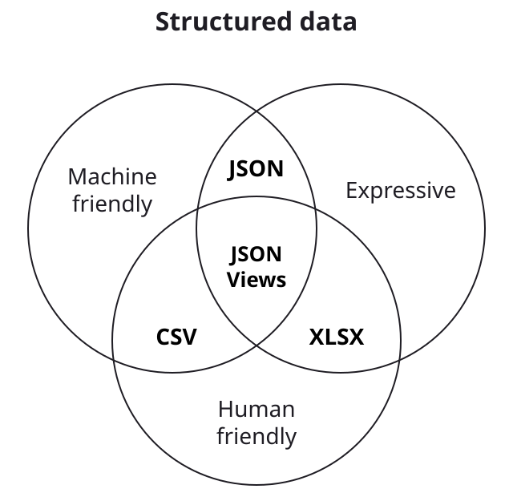
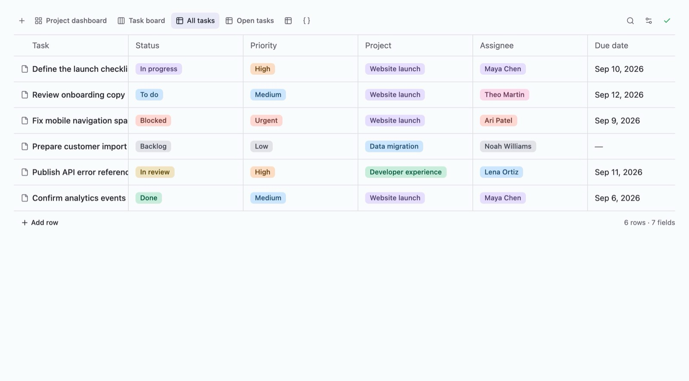
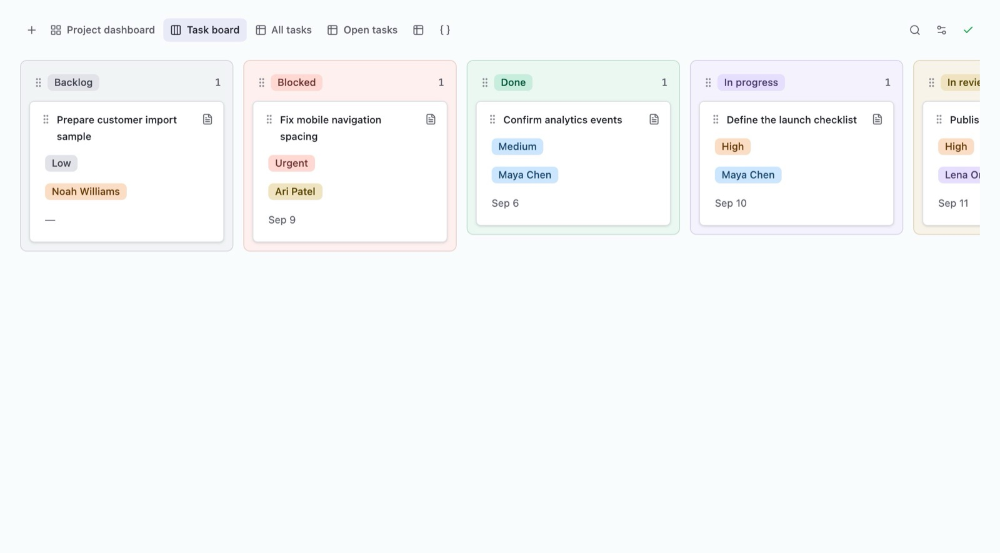
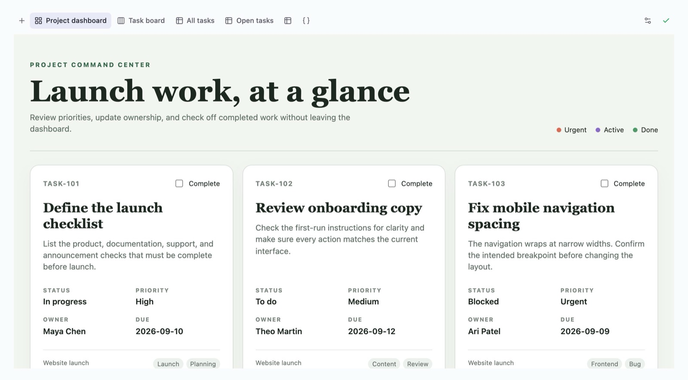
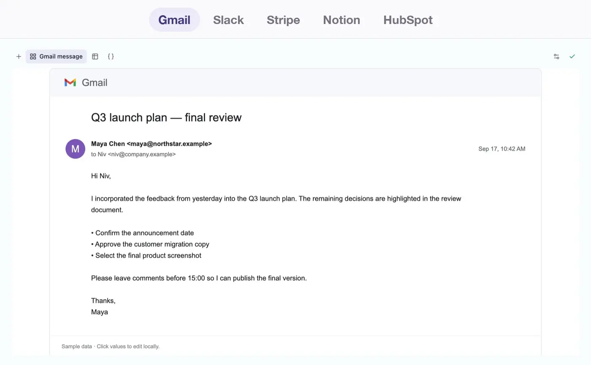

# JSON Views

**Data files that both humans and agents can easily view and edit.** JSON Views is an open-source JSON viewer and editor for browsers, React apps, local files, humans, and agents.

<p>
  <a href="https://json-views.com/"></a>
  &nbsp;
  <a href="#open-a-local-file"></a>
</p>

<a href="https://json-views.com/#/files/Templates%2FTask%20Management.json/views/All%20tasks"><picture><source media="(prefers-color-scheme: dark)" srcset="apps/web/public/home/claude-demo-dark.webp"></picture></a>

### Install JSON Views in your AI agent with one click

<p>
  <a href="https://json-views.com/install.html?agent=claude"><picture><source media="(prefers-color-scheme: dark)" srcset="docs/readme/button-claude-dark.svg"></picture></a>
  <a href="https://json-views.com/install.html?agent=codex"><picture><source media="(prefers-color-scheme: dark)" srcset="docs/readme/button-codex-dark.svg"></picture></a>
  <a href="https://json-views.com/install.html?agent=cursor"><picture><source media="(prefers-color-scheme: dark)" srcset="docs/readme/button-cursor-dark.svg"></picture></a>
  <a href="https://json-views.com/install.html?agent=grok"><picture><source media="(prefers-color-scheme: dark)" srcset="docs/readme/button-grok-dark.svg"></picture></a>
  <a href="#use-with-your-agent"><picture><source media="(prefers-color-scheme: dark)" srcset="docs/readme/button-copy-prompt-dark.svg"></picture></a>
</p>

## Why JSON Views

Today, the formats we use for structured data leave a gap:

- **CSV** is not expressive enough.
- **JSON** is hard for humans to navigate and edit.
- **Excel (XLSX)** is cumbersome for agents to navigate and edit.

JSON Views closes that gap with an editor that makes JSON files look like a **Notion database**. People can browse records, open pages, and edit fields while agents work with the same underlying JSON.

A small **`$jsonviews`** property inside the file holds the column schema and saved views of its important parts. Users can jump straight to the useful tables and pages instead of navigating the whole JSON tree. Agents can edit this property to help humans navigate JSON easily.

What Markdown does for documents, JSON Views does for structured data: it makes an expressive, machine-friendly format comfortable for people too.

<p align="center">
  <picture>
    <source media="(prefers-color-scheme: dark)" srcset="docs/readme/structured-data-dark.svg">
    
  </picture>
  &nbsp;
  <picture>
    <source media="(prefers-color-scheme: dark)" srcset="docs/readme/text-documents-dark.svg">
    
  </picture>
</p>

## What you can do with JSON Views

### View/Edit your data as a Notion-style table

Records become a typed table the moment you open the file. Dates get date pickers, statuses become colored tags, and every cell is editable. No schema, no setup.

<a href="https://json-views.com/#/files/Templates%2FTask%20Management.json/views/All%20tasks"><picture><source media="(prefers-color-scheme: dark)" srcset="apps/web/public/home/tasks-table-dark.jpg"></picture></a>

### View/Edit your data in a Kanban or an HTML view

Group the same records by status and drag cards between columns. Or build a dashboard in HTML that still edits the data underneath. Views are saved inside the file, so they travel with it.

<table>
  <tr>
    <td width="50%"><a href="https://json-views.com/#/files/Templates%2FTask%20Management.json/views/Task%20board"><picture><source media="(prefers-color-scheme: dark)" srcset="apps/web/public/home/tasks-board-dark.jpg"></picture></a></td>
    <td width="50%"><a href="https://json-views.com/#/files/Templates%2FTask%20Management.json/views/Project%20dashboard"><picture><source media="(prefers-color-scheme: dark)" srcset="apps/web/public/home/tasks-dashboard-dark.jpg"></picture></a></td>
  </tr>
</table>

### View/Edit your data as it will look in the app it goes to

Before your data goes to Gmail, Slack, Stripe, or Notion, see it the way that app will show it. HTML views render the JSON as the destination app. Every value stays editable, and every edit writes back to the file.

<a href="https://json-views.com/#/files/Templates%2FApp%20Views%2FGmail%20Message.json/views/Gmail%20message"><picture><source media="(prefers-color-scheme: dark)" srcset="apps/web/public/home/apps-dark.webp"></picture></a>

## About this repository

**Release status: public beta.** Feedback is welcome in [GitHub Issues](https://github.com/script-it/json-views/issues). For an example of consuming the published packages, see the [installed-package consumer](examples/consumer/README.md).

## Open a local file

```bash
npx @script-it/json-views ./data.json
```

The file opens in your browser on `127.0.0.1`, and edits save back to it; changes made elsewhere in the meantime are detected as conflicts. Add `--no-open` to print the URL for an agent or another tool instead. The [CLI README](packages/cli/README.md#local-file-and-agent-api) covers its local API and save guarantees.

## Use the public editor

[json-views.com](https://json-views.com/) lets you upload, paste, edit, and download JSON and CSV. Documents stay in your browser: the site has no upload backend, and share links carry the document in the URL fragment, which is never sent to the server. Treat a share link as public to anyone who receives it.

json-views.com records anonymous usage counts — which interface opened a document and whether the source was JSON or CSV — and never the filename, the document, or any value inside it. There is no persistent identifier and no cookie. Turn it off in Settings. The `@script-it/json-views-core`, `-react`, and CLI packages send no telemetry and make no network requests at all.

How the site stores documents, keeps tabs in sync, and builds its landing page is described in [apps/web](apps/web/README.md).

### Agent access in the browser

The open editor exposes `window.jsonViews` to DevTools, browser extensions, and in-page automation, and registers the same operations as [WebMCP](https://webmachinelearning.github.io/webmcp/) tools in browsers that support it. Run `jsonViews.help()`, or the `json_views_help` tool, for the full guide.

```js
const documents = jsonViews.list()
const tasks = jsonViews.get('tasks.json')
const inspection = jsonViews.diagnostics('tasks.json')

await jsonViews.create('notes.json', { notes: [] })
await jsonViews.patch('tasks.json', [
  { op: 'test', path: '/tasks/0/done', value: false },
  { op: 'replace', path: '/tasks/0/done', value: true },
])
```

Writes apply RFC 6902 patches atomically, preserve unrelated source text, and return structured diagnostics; a failed patch saves nothing. The [agent skill](skills/json-views/SKILL.md) documents every call.

## Automatic types and views

Ordinary JSON does not need `$jsonviews`. JSON Views predicts useful views in memory, without changing the file:

- Booleans, numbers, URLs, email addresses, ISO dates, and long text get matching editors.
- Short values repeated across records in category-like fields become selects with colored tags.
- Collections of similar records become tables.
- Records with a status-like field (`status`, `state`, `stage`, or `phase`) also get a Kanban board.

Saving an inferred view's settings writes it into `$jsonviews`, where it can be renamed and customized. The exact rules are in the [core package README](packages/core/README.md#inferred-types-and-views).

## Add views and types to JSON

JSON Views reads optional `$jsonviews` metadata from an object root:

```json
{
  "$jsonviews": {
    "version": 1,
    "schema": {
      "$.contacts[*].name": { "type": "text", "title": "Name" },
      "$.contacts[*].status": {
        "type": "select",
        "options": ["New", "Qualified", "Customer"]
      }
    },
    "views": [
      {
        "id": "contacts",
        "name": "Contacts",
        "path": "$.contacts",
        "columns": [
          { "label": "Name", "path": "$.contacts[*].name" },
          { "label": "Status", "path": "$.contacts[*].status" }
        ]
      }
    ]
  },
  "contacts": [
    { "name": "Ada", "status": "Customer" }
  ]
}
```

Built-in types are `text`, `markdown`, `html`, `number`, `checkbox`, `select`, `multi-select`, `date`, `url`, and `email`. Select options are suggestions rather than closed lists, and `optionColors` assigns each option a stable color from `gray`, `blue`, `green`, `yellow`, `orange`, `red`, `purple`, and `pink`.

Views can also be created in the editor: **New view** turns the current path into a page, table, or Kanban board. The [annotation specification](packages/core/README.md#annotation-specification) covers every field.

## Use it in React

```tsx
import { JSONContent } from '@script-it/json-views-react'
import '@script-it/json-views-react/styles.css'

export function Viewer({ source, save }: { source: string; save: (next: string) => Promise<void> }) {
  return (
    <JSONContent
      documentId="workspace:file-id"
      content={source}
      path="data.json"
      theme="inherit"
      edit={{
        isEditing: false,
        editContent: source,
        onEditChange: () => undefined,
        onCommitContent: save,
      }}
    />
  )
}
```

The packages are deliberately separated:

- `@script-it/json-views-core`: metadata inference and compilation, JSONPath subset, validation, view model, and source-preserving patches.
- `@script-it/json-views-react`: the extracted viewer UI plus type and widget registries.
- `@script-it/json-views`: the local file CLI and browser host; it installs the `json-views` executable.
- `@script-it/json-views-web`: the static upload/paste/download app.

Annotations can also be supplied separately through `metadata`, including for array and primitive roots. This preserves ordinary application JSON without adding `$jsonviews`.

Each package documents its own contract: see [React integration](packages/react/README.md#react-integration).

## Use with your agent

The repository includes a portable JSON Views skill at [`skills/json-views`](skills/json-views/SKILL.md). It teaches agents how to open local files, use revision-safe API writes, author `$jsonviews` metadata, and verify saved views.

Paste this into Claude Code, Cursor, Codex, or any coding agent:

```text
Set up JSON Views (https://github.com/script-it/json-views) for me:
1. Install its agent skill: `npx skills add script-it/json-views`.
   If that fails, copy the `skills/json-views` folder from the repo into your skills directory.
2. Read the skill so you know how to use JSON Views.
3. Ask me which JSON file to work on, open it with `npx @script-it/json-views <file>`,
   and suggest useful views for the data.
If you can control my browser instead, use json-views.com through WebMCP or `window.jsonViews.help()`.
```

The site also publishes the skill at [json-views.com/SKILL.md](https://json-views.com/SKILL.md), with its reference files beside it, so an agent can install it from a URL. The one-click buttons at the top of this README link to [json-views.com/install.html](https://json-views.com/install.html), which opens Claude Code, Codex, Cursor, or Grok with the install prompt; GitHub does not allow app links in a README directly.

## Develop

Requires Node.js 22.13+ in the 22 series, or Node.js 24+. React 18 and 19 are supported. The browser UI uses modern CSS, including nesting and `color-mix`; older browsers require a host-specific compatibility build.

```bash
npm ci
npm test
npm run check
npm run build
npm run dev
```

`npm run check:release` also installs the actual npm tarballs into an independent consumer and checks ESM, React SSR, strict TypeScript, browser bundling, and the installed CLI. CI runs Node 22/24 with React 18/19. Read [Contributing](CONTRIBUTING.md) before changing a public contract.

## License and trademarks

The source in this repository is MIT licensed; see [LICENSE](LICENSE).

The MIT license covers the code. It does not grant rights to the Script.it and JSON Views names, logos, or other brand assets, which remain the property of Script.it. A fork may use the code freely, but should carry its own name and marks rather than presenting itself as Script.it or JSON Views.
